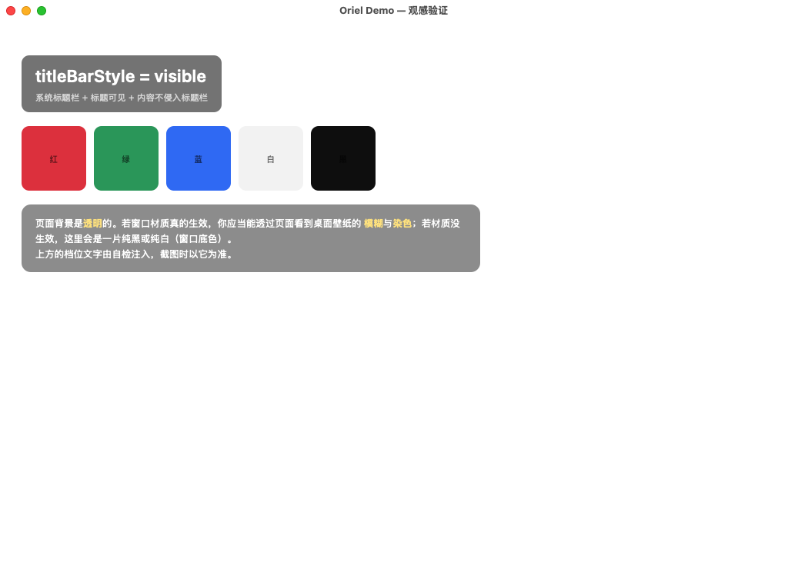
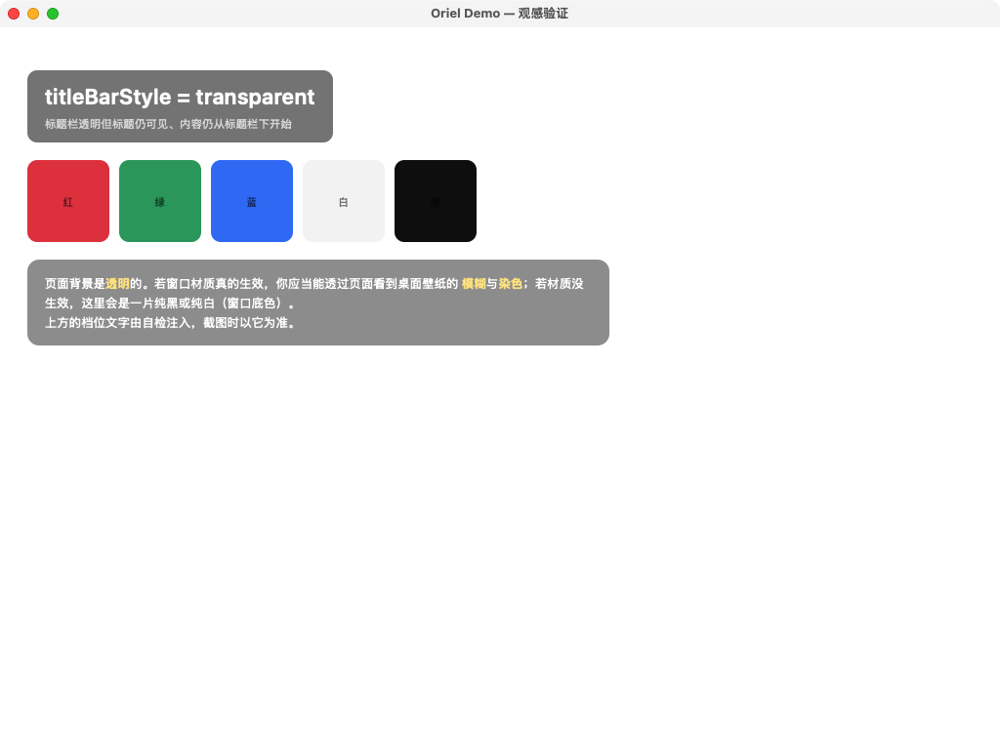
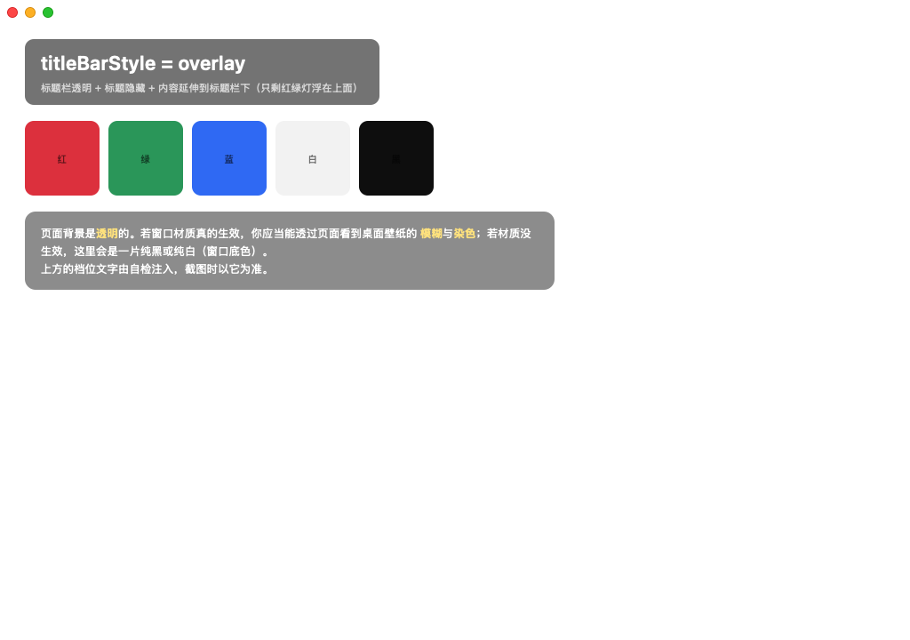
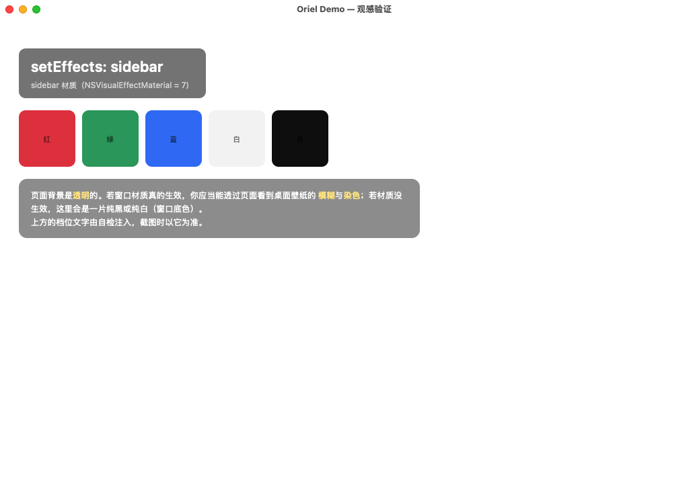

# 跨平台真机验证（Hyper-V 实验室）

> 目的不是"再跑一遍 CI"，而是跑 **CI 结构上覆盖不到的那一半**：不同发行版的库版本、
> 不同 CPU 架构、不同的桌面会话类型（X11 / Wayland / 无会话），以及最后那一层
> **"看起来对不对"**。
> 结论先给：两轮下来抓到 **8 个真问题**，其中 2 个是**进程级崩溃**、1 个是"应用在
> Ubuntu 22.04 上根本起不来"，还有 3 个是**所有 API 都成功但画面上什么都没有**
> （材质被白底挡住、托盘宽度归零、图标尺寸超限）。最后这一类只有真机看得见——
> 单测和 CI 永远是绿的。

## 1. 环境

宿主 Windows 10（19044）+ Hyper-V 内部交换机 `vLab`（192.168.100.0/24），三台机器走 SSH
自动执行同一套 demo 的自检。工装见 `hyperv-vm/`（`test-lab.ps1` / `start-lab.ps1` /
`deploy-run.ps1`）。

| 机器 | 系统 | 架构 | 关键版本 | 图形会话 |
|---|---|---|---|---|
| 宿主 | Windows 10 19044 | x64 | WebView2 运行时 | 有（桌面） |
| `lab-ubuntu` | Ubuntu 22.04 LTS | x86_64 | 内核 6.8；**WebKitGTK 4.0**（`libwebkit2gtk-4.0.so.37`）；GTK 3 | **Wayland**（gnome-shell，另有 XWayland） |
| `lab-macos` | macOS 15.8.1 | **x86_64（Intel）** | 无 .NET、无 Xcode CLT；**Hyper-V 虚拟显卡（8 MB 显存，无 Metal）** | **有**（登录后 `console user: pgyctt`） |

三台都**没有装 .NET**：产物用 `dotnet publish -r <rid> --self-contained true -p:PublishAot=false`
从宿主交叉发布，再 `tar` 流式推过去（`deploy-run.ps1` 的做法）。AOT 需要目标平台工具链，
在 Windows 上给 Linux/macOS 做不出来，所以这一轮验的是"自包含非 AOT"，与 CI 的 AOT 是两条路径
——两者都验到，覆盖面才完整。

## 2. 结果

`--selftest <mode>` 的结论行（`<MODE>-SELFTEST: PASS`）与退出码：

| 平台 / 会话 | 跑的模式 | 结果 |
|---|---|---|
| Windows 10 x64（桌面） | 20 | **20/20 PASS** |
| Ubuntu 22.04 **X11**（`GDK_BACKEND=x11`） | 20 | **20/20 PASS** |
| Ubuntu 22.04 **Wayland** | 19 | **19/19 PASS** |
| macOS 15 **Intel，无图形会话** | 20 | **20/20 PASS** |
| macOS 15 **Intel，已登录图形会话** | 21（新增 `visuals`） | **21/21 PASS** |

四组全绿，但**其中一部分是 SKIP**——下面第 4 节说清哪些断言在什么环境里被跳过、
为什么跳过不等于放过。

第 5 行是"观感"那一轮：登录桌面会话后补跑的 `--selftest visuals`，它验的是
**看起来对不对**（标题栏三档、材质、阴影、Dock 显隐、托盘图标），而不是"命令调得通"。

## 3. 找到并修掉的问题

### 3.1 Ubuntu 22.04 上应用**起不来**：只认 WebKitGTK 4.1

现象：建第一个窗口时

```
System.DllNotFoundException: Unable to load shared library 'libwebkit2gtk-4.1.so.0'
   at GtkNative.WebkitWebContextGetDefault()
   at LinuxAssetScheme.Register(...)
```

根因：WebKitGTK 在 2.40 把 GTK3 那一支的 soname 从 `libwebkit2gtk-4.0.so.37` 改成了
`libwebkit2gtk-4.1.so.0`，但**发行版不跟着改**——Ubuntu 22.04 至今仍以 4.0 这个名字发安全更新
（里面的 WebKit 是新的，只是文件名旧）。本库按 4.1 硬加载，于是在 22.04 上一行界面都出不来。

**为什么 CI 抓不到**：`ubuntu-latest` 是 24.04，只有 4.1。

修法：`Interop/LinuxLibraryResolver.cs` —— 用 `NativeLibrary.SetDllImportResolver` 把
"库名 → 句柄"的解释权拿回来，按 `4.1 → 4.0(.so.37) → 4.0(.so.0)` 依次尝试；
注册时机挂在 `GtkNative` 的静态构造函数上（`DllImport` 的解析发生在第一次调用时，
早一步晚一步都不行）。**换库是安全的**：本库用到的 32 个 `webkit_*` 与 1 个 `jsc_*` 符号
在 4.0 里逐个探过，一个不缺——两个名字背后是同一套 C API。

首版还踩了个坑：回退名写成 `libwebkit2gtk-4.0.so.0`（照 4.1 的 `.so.0` 类推），
真机上照样找不到——4.0 的 libtool 版本号是 `.so.37`（JSC 是 `.so.18`）。

### 3.2 Intel Mac 上建窗即崩：`NSRect` 的 ABI 不是一个架构的事

现象（macOS 15 / x86_64）：

```
*** Terminating app due to uncaught exception 'NSInternalInconsistencyException',
    reason: 'Invalid parameter not satisfying: CGRectContainsRect(..., frame).
             self=<NSWindow: …> frame={{1024, 0}, {nan, 0}}'
```

根因：`NSRect` 是 32 字节的 double 聚合。**arm64 把它当 HFA 放进 v0–v3，x86_64 的 SysV 把它
整个压到栈上**。我们此前把矩形拆成 4 个 `double` 参数——在 arm64 上"碰巧对"，
在 Intel 上 4 个 double 进了 xmm 寄存器、栈上是垃圾，AppKit 收到 `{nan, 0}` 的 frame。

**为什么 CI 抓不到**：`macos-latest` 是 arm64。

修法：引入 `ObjCRuntime.NSRect` 结构体与一组 `SendIdRect*` / `SendVoidRect*` 签名，
矩形一律走结构体（封送层按平台 ABI 处理）。受影响的共 5 处：`NSWindow` 建窗、
`WKWebView initWithFrame:configuration:`、`NSVisualEffectView initWithFrame:`、
两处 `setFrame:`、`setFrame:display:`（简化全屏 / 跨屏全屏）、`NSTrackingArea initWithRect:…`。
`SendIdDouble4` 保留给"四个**独立标量**"的 selector（`+[NSColor colorWithSRGBRed:…]`），
并在注释里写明这个区别。

> 顺带收获：修好之后 macOS 上 86 条窗口断言一次过——说明 arm64 那条路径的实现是好的，
> 坏的只有 ABI 声明。

### 3.3 没有图形会话时，菜单与托盘会让进程 abort

现象：`--selftest menu` 在 macOS VM 上 `exit=134`（SIGABRT）：

```
NSInternalInconsistencyException: 'Nil screen'
  at -[NSPopupMenuWindow _availablePositioningRectForMenuType:onScreen:]
```

根因：`NSMenu` 弹出与 `NSStatusBar` 状态项都要求有窗口服务器。没有时不是"不生效"，
而是抛 ObjC 异常——托管侧接不住，进程直接没了，调用方连错误码都拿不到。

修法：`MacOSSession.RequireScreen(...)` —— 调这两个能力之前先问 `NSScreen.screens`，
为空就抛 `NotSupportedException`（分发器统一翻成 `not_supported`）。硬崩溃变成可处理的失败。

### 3.4 `path.downloadDir()` 的断言假设了英文目录名（自检错，不是库错）

现象：中文 Ubuntu 上 `path.downloadDir()` 返回 `/home/pgyctt/下载`，而自检断言
`/[\\/]Downloads$/`，于是红。

结论：**库是对的**（Linux 上这个目录来自 XDG 用户目录，本来就随系统语言变），
错的是断言。改成"绝对路径且不是家目录本身"——那才是这条断言真正要保证的东西。

### 3.5 `class_getInstanceMethod` 的第二个参数是 `SEL`，不是 C 字符串

现象：`setEffects` 每次都打一条诊断——"这个系统上的 WKWebView 没有 drawsBackground"，
在 macOS 15 上**永远**如此，换哪个版本都一样。

根因在 P/Invoke 声明：

```csharp
// 错的：第二个参数被 marshaling 成 char*
[LibraryImport(ObjCLib, StringMarshalling = StringMarshalling.Utf8)]
internal static partial nint class_getInstanceMethod(nint cls, string name);
```

ObjC runtime 的签名是 `Method class_getInstanceMethod(Class, SEL)`。传一个 `char*`
过去，runtime 会把字符串的头几个字节当作 `objc_selector` 结构去解析，**返回 nil**。
于是"这个方法存不存在"的答案恒为"不存在"，而这个函数正是所有
"本系统支不支持 X"判断的依据。

**为什么危险**：它不崩、不报错，只是让一整类能力判断集体失效。症状出现在很远的地方
（"材质看不见"），日志里的解释却是"这个系统没有那个属性"——把人指向系统版本而不是这行声明。

修复：签名改成 `nint sel`，调用方先 `ObjCRuntime.Sel("setDrawsBackground:")`。
（同一批里把 `class_getInstanceVariable` 的注释也补清楚了：它**不查父类**。）

### 3.6 macOS 15 移除了 WKWebView 的私有 `drawsBackground`，材质被页面白底挡住

`NSVisualEffectView` 挂上去了、`material` 对了、窗口 `opaque=false`、页面 CSS 也是
`rgba(0,0,0,0)`——**画面仍然是纯白**。

取证（不是猜）：

```text
[visuals-selftest] WKWebView 内部：WKFlippedView(op=0,bg=nil)
[visuals-selftest] 页面计算背景："{"html":"rgba(0, 0, 0, 0)","body":"rgba(0, 0, 0, 0)"}"
```

再逐层扫 ivar（`class_copyIvarList`，沿继承链）：

```text
[OrielWeb] WKWebView 的 drawsBackground 探测失败，ivar 扫描结果（逐层父类）：
  [28 ivars: ] [136 ivars: _hasDrawMatrix/.../_backgroundColor/...] [3 ivars: ] [1 ivars: ]
```

**WKWebView 的 28 个 ivar 里没有 `_drawsBackground`**，`respondsToSelector` 对
`setDrawsBackground:` 也是 false。这个私有属性在 macOS 15 上被移除了（Tauri/tao
依赖的那条 KVC 路径在新系统上已经不通）。

替代品是**公开 API** `WKWebView.backgroundColor`（macOS 10.14+）。用 JXA 在 VM 上实测：

```text
setBackgroundColor(clearColor) → backgroundColor.alphaComponent = 0   ✔ 真的生效
setOpaque(false)             → isOpaque 仍返回 true                  ✘ 被 WKWebView 覆写
```

所以 `isOpaque` **不能**当判据（WKWebView 恒返回 YES），要读 `backgroundColor` 的 alpha。

修复：优先走公开的 `setBackgroundColor:`（`clearColor` / `windowBackgroundColor`），
老系统才回退私有 KVC；**设完读回 alpha 校验**，不匹配就报诊断——不然下次它又静默失效。

### 3.7 托盘状态项长度设成 0：一个"存在但看不见"的托盘

现象：`tray.IsVisible = true`、`[button image]` 非空、`NSStatusBar` 里确实多了一项，
但**菜单栏那一格是空的**。连 `NSStatusItem.title = "ORIEL"` 的纯文字也不显示。

根因：

```csharp
// 注释写的是"有文字时给按钮一个固定宽度"
ObjCRuntime.SendVoidDouble(_statusItem, ObjCRuntime.Sel("setLength:"),
    string.IsNullOrEmpty(title) ? VariableStatusItemLength : 0);   // ← 0
```

macOS 的 `0` 不是"自动"，是**零宽**。宽度归零后状态项仍在、`isVisible` 仍为 true、
图标也仍挂着，但画面上什么都没有——这是最难排查的一类"没坏但看不见"。

修复：长度**始终**交给 AppKit 自适应（`NSVariableStatusItemLength = -1`）。
想固定宽度得先量文字宽度，没有理由在这里做那件事。

### 3.8 512×512 的图标放不进状态栏

修好长度之后，用 `app.png`（512×512）仍看不见图标——`NSStatusItem` 按 `image.size`
（**点**）分配宽度，512 点宽会被系统钳制，钳制的结果是**不绘制**。

`NSStatusItem` 不会替你缩放。Tauri 的 tao 同样把托盘图标归一到 18 点。修复：
设置前按最长边缩放到 18 点（保持宽高比），`SetIcon`（运行期换图标）与 `ApplyIcon`
（创建期）走同一条归一。

顺带纠正一个配置误用：`IconAsTemplate` 默认 true 表示"按 alpha 变成单色剪影、
由系统反色"。彩色图标（demo 的蓝底白窗 `app.png`）套上去会丢掉全部配色、只剩实心块。
demo 现在显式设 false——模板图只适合单色线条图标。

## 4. 自检里的环境判据：从"猜"改成"问"

这一轮最大的方法论收获：**判断平台能力不能看环境变量**。

- `WAYLAND_DISPLAY` 在 Wayland 会话里**可以不设**：GDK 会默认连 `wayland-0`
  （用最小的 GTK 探针实测：只设 `DISPLAY=:0`，`gdk_display_get_name` 仍返回 `wayland-0`）。
  原来自检按这个变量判"是不是 Wayland"，于是把 Wayland 当 X11，`setCursorPosition`
  的断言就红了。现在改成**发出去看结果**：成功走 X11 路径、明确 `not_supported` 走 Wayland 路径。
- macOS 的"有没有图形会话"用 `CGSessionCopyCurrentDictionary()`（不在会话里返回 NULL）。
  `NSScreen.screens.count` 是更弱的信号——实测停在登录窗口时它**仍然非空**，
  只能当退路。
- Wayland 下窗口尺寸由**合成器**决定：`gtk_window_resize`、`gtk_window_set_default_size`、
  子控件 `set_size_request`，甚至 `gdk_window_resize` 都不改变 GTK 的分配尺寸
  （连建窗时请求的 800×600 都会被换成 852×689）。所以 `geometry` / `windowevents` /
  `menubar` 里依赖"改尺寸"的断言在 Wayland 下 SKIP，并打印实测值。

**SKIP 不等于放过**：每条跳过都带判据（`LinuxDisplay.IsWayland` / `MacDisplay.HasScreenSession`），
在判据不成立的平台上断言照旧严格。X11 与 Windows 走的是完整断言路径。

## 5. 复现

```powershell
# 1) 在仓库根目录生成载荷（-Rid 换成目标平台，见下面的表）
pwsh tools\publish-vm-payload.ps1 -Rid linux-x64

# 2) 推送 + 执行。deploy-run.ps1 属于外部仓库 hyperv-vm\scripts，不在本仓库里
cd hyperv-vm\scripts
.\test-lab.ps1                 # 先看三平台是否连通
.\start-lab.ps1 -TimeoutSec 300
.\deploy-run.ps1 -Payload <仓库>\.drill\vm\linux-x64 -Command './OrielDemo --selftest window'

# macOS 上要逐个模式跑（没有 timeout 命令，用脚本自带看门狗）
```

四个载荷各自对应一次验证，命名就是 RID：

| 载荷 | 用于 |
|---|---|
| `.drill\vm\linux-x64` | Linux VM（X11 与 Wayland 两个后端） |
| `.drill\vm\osx-x64` | macOS VM（Intel） |
| `.drill\vm\osx-visual` | 观感验证时另发的一份（同参数，见 §5.1），与 `osx-x64` 只差 `OrielDemo.dll` |
| `.drill\vm\win-x64` | Windows VM |

Windows 载荷用 `tools/publish-vm-payload.ps1` 生成，与其余三个走同一组参数：

```powershell
pwsh tools\publish-vm-payload.ps1 -Rid win-x64
.\deploy-run.ps1 -Payload .drill\vm\win-x64 -Command '.\OrielDemo.exe --selftest window'
```

`--self-contained true -p:PublishAot=false` 这组参数不是可选项，脚本把它们和一条断言放在一起：
**发布完必须是 JIT 运行时**（输出目录里要有 `coreclr`）。漏掉 `-p:PublishAot=false` 会得到 AOT 产物，
而 AOT 不能从宿主机交叉发布到别的平台（需要目标平台的链接器），症状是 link 阶段报
`unrecognised emulation mode`——看起来像工具链坏了，实际是参数给错了。

Windows 侧的载荷不能用**交叉发布**顶替：`deploy-run.ps1` 是把载荷推给目标机再执行，
而 Windows VM 上跑的必须是 win-x64 的应用宿主与托管依赖。这也正是这条线存在的理由——
CI 的 `smoke-windows` 跑在托管 runner 上（有 SDK、有 NuGet 缓存），VM 这条验的是**干净机器没有 SDK 也能跑**。
两者不重复。

Linux 侧要显式给显示后端：`DISPLAY=:0 XAUTHORITY=$HOME/.Xauthority`，
验 X11 时再加 `GDK_BACKEND=x11`。

### 5.1 观感验证（`--selftest visuals`）

这一批验的是"看起来对不对"，跑法不同：它会把窗口逐档切成
visible / transparent / overlay，再依次套 sidebar / hudWindow 材质，每档读回
AppKit 的真实状态并断言，最后验 Dock 显隐与托盘。

```bash
# 断言 + 每档停留 6 秒（供人盯着看）
ORIEL_VISUALS_DWELL=6 ./OrielDemo --selftest visuals

# 同时把每档的窗口截图存下来（真实颜色，见下面的坑）
ORIEL_VISUALS_SNAPSHOT=$HOME/shots ./OrielDemo --selftest visuals

# 只停在某一档，其余档照常断言但不停
ORIEL_VISUALS_ONLY=sidebar ORIEL_VISUALS_DWELL=25 ./OrielDemo --selftest visuals
```

页面是 `visuals.html`，**背景必须是透明的**——页面一旦铺了不透明底色，材质就被盖住，
"材质没生效"与"页面挡住了"看起来一模一样。

### 5.2 截图的三个坑（都踩过）

取一张能看出观感的图不容易，三条路各有各的失效方式：

| 手段 | 结果 |
|---|---|
| Hyper-V `GetVirtualSystemThumbnailImage` | 文档说 RGB565，**实测解出来 R 通道恒为 0**：纯白 `#F5F5F5` 与纯黑 `#111` 转完都是 `#0008F0`。**颜色完全不可信**，只能看布局与存在性 |
| macOS `screencapture` | 需要"屏幕录制"权限；没授权时只得到菜单栏 + 一片灰 |
| `CGWindowListCreateImage`（自截） | 截**自己进程**的窗口不需要权限，颜色真实（`MacScreenCapture.cs`）。但 **BehindWindow 材质拍不到**——它渲染的是单个窗口的图层树，背后没有内容可混合 |

所以这一轮的观感结论来自"两路对照"：**结构看 Hyper-V 缩略图**（标题栏、红绿灯、
Dock、菜单栏位置），**颜色与细节看自截 PNG**。材质的模糊则两路都拍不到，见第 6 节。

### 5.3 观感基线

取证图存在 `docs/verification/macos/`。除最后一张外都来自"自截"，颜色真实。

**`titleBarStyle = visible`**：系统标题栏 + 标题居中 + 红绿灯三键 + 内容从标题栏下方开始。



**`titleBarStyle = transparent`**：标题栏与内容融为一体（分隔线消失），标题仍在、内容位置不变。



**`titleBarStyle = overlay`**：标题消失，内容整体上移并延伸到标题栏之下，只剩红绿灯浮在上面。
对比前一张的档位卡片纵向位置即可看出这段位移。



**`setEffects(sidebar)`**：`NSVisualEffectView` 已挂上、页面透明。这张里客户区仍是纯白——
不是材质没生效，是这台 VM 没有 GPU 合成，模糊出不来（第 6 节）。



**托盘图标**（此图为 Hyper-V 缩略图，颜色失真；看的是"那一格有没有东西"）：
菜单栏左侧的输入法图标 "A" 左边多了一个 18 点的应用图标。


## 6. 已知限制

- **vibrancy 的"模糊"在 VM 上验不了**：`system_profiler` 报的是
  `Hyper-V Graphics`、8 MB 显存、**没有 Metal 支持项**。登录会话后跑 `visuals`，
  材质的**结构**全对——`NSVisualEffectView` 在 contentView 里、frame = 1024×720、
  `material` = 7/13、窗口 `opaque=false` 且背景 alpha=0、webview 背景 alpha=0、
  页面计算背景 `rgba(0,0,0,0)`——但画面上是纯色。
  真实 Mac 有 GPU 合成，模糊会出来；**这台 VM 上只能证明"该连的都连上了"，
  不能证明"看起来是毛玻璃"**。要在有 GPU 的真机上补一次目视。
- **架构覆盖**：Linux 与 macOS 都是 x64；arm64 由 CI 覆盖（`osx-arm64`）。两边都覆盖到了，
  但**同一平台的两个架构没有在同一台机器上对比过**（那正是 3.2 那类 bug 的温床）。
- **Linux 只验了 Ubuntu 22.04**：Debian / Fedora / Arch 的 GTK 与 WebKit 版本组合更多，
  尤其 Fedora 的 WebKitGTK 更新更快（更容易撞上"4.1 存在但符号变了"）。
- **没有验 AOT**：VM 里跑的是自包含非 AOT（宿主交叉发布的限制）。AOT 由 CI 覆盖。
- macOS VM 是 Intel + macOS 15；更老的系统（11/12）没有取证，而本库有若干
  "macOS 13.3+ 才有"的分支（`WKWebView.setInspectable:` 等），那些分支只做了存在性探测。
